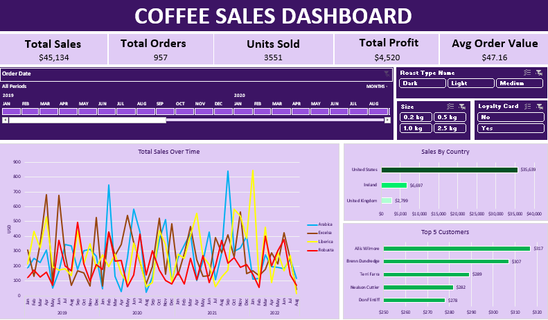
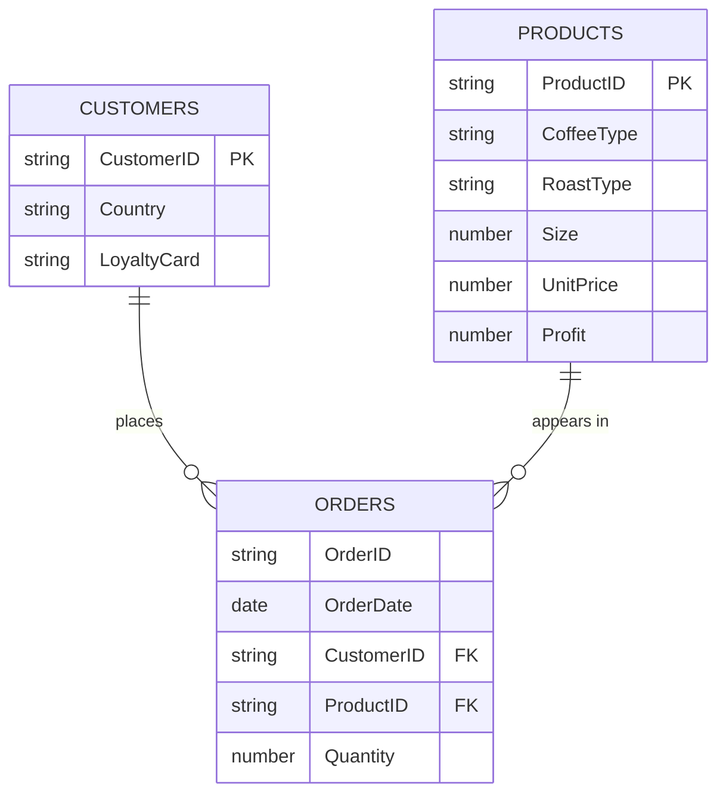

# Coffee sales dashboard (Excel)

An interactive Excel dashboard for a coffee bean retailer. I joined three raw tables (orders, customers, products), cleaned and enriched the data with lookup formulas, then built KPIs, pivot charts, slicers and a timeline on top of it. The whole thing runs in a single `.xlsx` file with no macros and no external connections.



*Screenshot of the final dashboard, saved in this repo at `images/dashboard.png`.*

## Contents

- [Project summary](#project-summary)
- [Headline numbers](#headline-numbers)
- [Dataset](#dataset)
- [Workbook structure](#workbook-structure)
- [How I built it](#how-i-built-it)
- [KPI definitions](#kpi-definitions)
- [Dashboard features](#dashboard-features)
- [Findings](#findings)
- [Recommendations](#recommendations)
- [Assumptions and limitations](#assumptions-and-limitations)
- [Design decisions](#design-decisions)
- [How to use this repo](#how-to-use-this-repo)
- [Skills practised](#skills-practised)

## Project summary

The business sells four types of coffee beans (Arabica, Excelsa, Liberica, Robusta) in three roasts (light, medium, dark) and four package sizes (0.2, 0.5, 1 and 2.5 kg). Customers are in the United States, Ireland and the United Kingdom.

The problem is that the data lives in three separate tables. The orders table only has IDs and a quantity. Prices, coffee types and profit are in the products table, and names, countries and loyalty status are in the customers table. Nobody can answer "how much did we sell in Ireland?" or "which coffee earns the most profit?" until those tables are joined.

I set out to answer these questions:

1. How do sales move month to month, and how does that differ by coffee type?
2. Which countries bring in the most revenue?
3. Who are the top customers, and does the business depend on them?
4. Do roast type, package size or loyalty card status change what people buy?
5. What are the headline numbers: sales, orders, units, profit and average order value?

## Headline numbers

| Metric | Value |
|---|---|
| Total sales | $45,134 |
| Total profit | $4,520 (10.0% margin) |
| Total orders | 957 |
| Units sold | 3,551 |
| Average order value | $47.16 |
| Customers who ordered | 913 (out of 1,000 on file) |
| Date range | 2 Jan 2019 to 19 Aug 2022 |

## Dataset

Source: [Coffee orders data on Kaggle](https://www.kaggle.com/datasets/mohammadkaiftahir/coffee-orders-data) (published by mohammadkaiftahir). I downloaded the raw Excel file, which contains three sheets: orders, customers and products. In the raw `orders` sheet only Order ID, Order Date, Customer ID, Product ID and Quantity were filled in. Everything else was added during this project.

The workbook is organised around three tables.

| Sheet | Rows | What it holds |
|---|---|---|
| `orders` | 1,000 | One row per order line: Order ID, Order Date, Customer ID, Product ID, Quantity |
| `customers` | 1,000 | Customer ID, name, email, phone, address, city, country, postcode, loyalty card (Yes/No) |
| `products` | 48 | Product ID, coffee type, roast type, size, unit price, price per 100g, profit per unit |

Rows in `orders` are order lines, not orders. A single order can contain several products, so the 1,000 lines belong to 957 distinct Order IDs (926 orders have one line, 31 have two to five).

The Product ID encodes three attributes: `R-M-1` is Robusta, Medium roast, 1 kg.



## Workbook structure

| Sheet | Purpose |
|---|---|
| `Dashboard` | Final dashboard: KPI cards, three charts, three slicers, one timeline |
| `TotalSales` | Pivot table and line chart source: sales by year and month, split by coffee type |
| `KPI` | Pivot table plus `GETPIVOTDATA` formulas that feed the KPI cards |
| `CountryBarChart` | Pivot table for sales by country |
| `Top5Customers` | Pivot table for the five highest-spending customers |
| `orders` | Order lines with the lookup and calculated columns (Excel Table `Orders`) |
| `customers` | Customer reference data |
| `products` | Product reference data |

## How I built it

### 1. Gather the data

The raw `orders` sheet only had five filled columns. I filled in the rest by looking values up from the other two tables.

Customer fields use `XLOOKUP`, matched on Customer ID:

```excel
=XLOOKUP(C2, customers!$A$1:$A$1001, customers!$B$1:$B$1001, , 0)
```

Product fields use `INDEX` and `MATCH`. This one formula fills coffee type, roast type, size and unit price, because the column number comes from matching the header in row 1 instead of being typed in:

```excel
=INDEX(products!$A$1:$G$49,
       MATCH($D2, products!$A$1:$A$49, 0),
       MATCH(I$1, products!$A$1:$G$1, 0))
```

The `$` signs matter here. `$D2` locks the column so the Product ID is always read from column D, and `I$1` locks the row so the header is always read from row 1. That lets me drag the formula across and down without editing it.

I used `XLOOKUP` for customers and `INDEX/MATCH` for products on purpose. `XLOOKUP` returns one column per formula, so I needed three of them (name, email, country). `INDEX/MATCH` with a dynamic column lookup needed only one.

### 2. Clean and format

- Blank emails. 204 of the 1,000 customers have no email address. `XLOOKUP` returns `0` for a blank cell, so I wrapped the lookup in an `IF` to return an empty string instead:

  ```excel
  =IF(XLOOKUP(C2, customers!$A$1:$A$1001, customers!$C$1:$C$1001, , 0)=0, "",
      XLOOKUP(C2, customers!$A$1:$A$1001, customers!$C$1:$C$1001, , 0))
  ```

- Duplicates. I ran Remove Duplicates across the orders data and none were found.
- Dates. Formatted as `dd-mmm-yyyy` (for example `05-Sep-2019`). Day-first and month-first formats get confused easily, and a spelled-out month removes the doubt.
- Size. Custom number format `0.0 "kg"`, so `0.5` displays as `0.5 kg` without changing the underlying number.
- Currency. Unit Price and Sales are formatted as US dollars.

### 3. Add calculated columns

| Column | Formula | Why |
|---|---|---|
| Sales | `=L2*E2` | Unit price times quantity |
| Coffee Type Name | Nested `IF`: `Rob` to Robusta, `Exc` to Excelsa, `Ara` to Arabica, `Lib` to Liberica | Full names read better on charts than codes |
| Roast Type Name | Nested `IF`: `M` to Medium, `L` to Light, `D` to Dark | Same reason |
| Loyalty Card | `XLOOKUP` on Customer ID | Needed for the loyalty slicer |
| Profit | Profit per unit from `products`, times Quantity | Needed for the profit KPI |
| New Orders | `=IF(COUNTIF($A$2:$A2,$A2)=1,1,0)` | Counts each Order ID once (see below) |

The New Orders column deals with the order-line problem. Because one order can span several rows, counting rows would overstate the number of orders. The formula looks at every Order ID from row 2 down to the current row. If this is the first time the ID has appeared it returns 1, otherwise 0. Summing the column gives 957 distinct orders instead of 1,000 lines.

### 4. Turn the range into an Excel Table

I converted the orders range into a Table named `Orders` (Ctrl+T). I added the Loyalty Card column after the first pivot table already existed, and the pivot picked it up after a refresh with no change to the data source. With a plain range it would have stopped at the old last column.

### 5. Build the pivot tables and charts

All four pivot tables read from the same `Orders` table and share one pivot cache. That is what lets one slicer control all of them.

| Pivot | Rows | Columns | Values | Chart |
|---|---|---|---|---|
| Total sales | Order Date grouped by year and month | Coffee Type Name | Sum of Sales | Line chart, one line per coffee type |
| Country | Country, sorted so the top country is on top | none | Sum of Sales | Bar chart |
| Top 5 customers | Customer Name with a Top 5 value filter on Sum of Sales | none | Sum of Sales | Bar chart |
| KPI | none | none | Sum of Sales, Profit, Quantity, New Orders | none (feeds the KPI cards) |

I used the tabular report layout with grand totals and subtotals turned off, hid the field buttons on each chart, and added axis titles, data labels and a consistent purple theme.

### 6. Add slicers and a timeline

- Timeline on Order Date (months)
- Slicer for Roast Type Name
- Slicer for Size
- Slicer for Loyalty Card

Each control is connected to every pivot table through Report Connections, including the KPI pivot. That means the KPI cards at the top of the dashboard change when you filter, not just the charts.

### 7. Assemble the dashboard

On a new `Dashboard` sheet I cut and pasted the charts and controls from the working sheets, snapped them to the cell grid by holding Alt while dragging, and added a title banner and five KPI cards. Then I hid gridlines, headings, the formula bar and the sheet tabs so the sheet only shows the dashboard. I left the scroll bars on so people on smaller screens can still scroll.

## KPI definitions

The KPI cards read from the `KPI` sheet, which uses `GETPIVOTDATA` against the KPI pivot table so the numbers follow the filters.

| KPI | Definition | Formula on the KPI sheet | Value (no filters) |
|---|---|---|---|
| Total sales | Sum of Unit Price x Quantity | `=IFERROR(GETPIVOTDATA("Sum of Sales",$A$2),0)` | $45,134 |
| Total orders | Count of distinct Order IDs | `=IFERROR(GETPIVOTDATA("Sum of New Orders ",$A$2),0)` | 957 |
| Units sold | Sum of Quantity | `=IFERROR(GETPIVOTDATA("Sum of Quantity",$A$2),0)` | 3,551 |
| Total profit | Sum of profit per unit x Quantity | `=IFERROR(GETPIVOTDATA("Sum of Profit",$A$2),0)` | $4,520 |
| Average order value | Total sales divided by total orders | `=IFERROR(B5/B6,0)` | $47.16 |

Average order value divides by distinct orders (957), not order lines (1,000). Using lines would give $45.13, which understates what a customer spends per purchase.

`IFERROR(..., 0)` stops the cards from showing an error when a filter combination returns no rows.

## Dashboard features

- Line chart of monthly sales by coffee type
- Bar chart of sales by country
- Bar chart of the top five customers
- Five KPI cards: total sales, total orders, units sold, total profit, average order value
- Timeline to select any range of months
- Slicers for roast type, package size and loyalty card status
- Every chart and every KPI card responds to every filter

## Findings

All figures below come from the full dataset with no filters applied. I checked them against the raw data outside Excel as well.

### Sales by country

| Country | Sales | Share | Orders |
|---|---|---|---|
| United States | $35,639 | 79.0% | 743 |
| Ireland | $6,697 | 14.8% | 146 |
| United Kingdom | $2,799 | 6.2% | 68 |

The US accounts for about four of every five dollars. Average order value is similar in all three countries ($41 to $48), so the gap comes from how many orders each country places, not from how much each order is worth.

### Sales and profit by coffee type

| Coffee | Sales | Share of sales | Profit | Margin | Share of profit |
|---|---|---|---|---|---|
| Arabica | $11.8k | 26.1% | $1,059 | 9.0% | 23.4% |
| Excelsa | $12.3k | 27.3% | $1,354 | 11.0% | 29.9% |
| Liberica | $12.1k | 26.7% | $1,567 | 13.0% | 34.7% |
| Robusta | $9.0k | 20.0% | $540 | 6.0% | 12.0% |

Sales are spread fairly evenly, but profit is not. Liberica makes up 27% of sales and 35% of profit. Robusta is the weakest on both counts: the lowest sales, and a 6% margin that is less than half of Liberica's.

### Package size

| Size | Sales | Share of sales | Units sold |
|---|---|---|---|
| 0.2 kg | $3,308 | 7.3% | 892 |
| 0.5 kg | $7,030 | 15.6% | 943 |
| 1 kg | $11,011 | 24.4% | 875 |
| 2.5 kg | $23,786 | 52.7% | 841 |

Customers buy roughly the same number of packages of each size (841 to 943), so revenue is driven almost entirely by price per package. The 2.5 kg bag brings in more than half of all sales. Margin is about 10% at every size, so a bigger bag does not earn a better margin, it just earns more dollars.

### Roast type

Light roast leads with 38.5% of sales ($17.4k), then medium at 32.3% and dark at 29.2%. Margins are all close to 10%. Light roast also has the highest average order value ($54 against $42 for dark). Buyers pick the same sizes across roasts, so the gap comes from price: the average unit price of a light roast line is $14.36, against $11.45 for dark.

### Customers and loyalty

- The top five customers (Allis Wilmore, Brenn Dundredge, Terri Farra, Nealson Cuttler, Don Flintiff) spent between $278 and $317 each, and together make up only 3.3% of sales. There is no customer concentration risk.
- Of the 913 customers who ordered, only 25 (2.7%) ordered more than once. Almost everyone buys one time.
- Customers with a loyalty card generated 46.3% of sales and have a slightly lower average order value than customers without one ($45.10 against $49.10). In this data the card does not show higher spending per order.

### Trend over time

Annual sales were $12.2k in 2019, $12.1k in 2020 and $13.8k in 2021. The data for 2022 stops on 19 August, so the $7.1k for that year is partial.

Comparing the same months each year gives a flatter picture. January to June sales were $6.3k (2019), $6.4k (2020), $6.1k (2021) and $5.9k (2022). The strong 2021 total came from the second half of that year. Monthly sales are volatile with no clear seasonal pattern: February 2020 was the best month ($1,798) and April 2019 the second best ($1,681).

## Recommendations

These follow from the numbers above. I would treat them as hypotheses to test, not conclusions.

1. Review Robusta pricing or cost. It has the lowest sales and a 6% margin. Even a small price increase or a cheaper supplier would move profit more than selling more of it.
2. Promote Liberica and Excelsa. They produce 65% of profit from 54% of sales.
3. Push the 2.5 kg size. It earns the same margin as the others but brings in far more revenue per order. Bundles or a discount on the larger bag could move customers up from the 0.5 kg and 1 kg sizes.
4. Work on repeat purchases. With 97% of customers ordering once, a follow-up offer or a reorder reminder has more room to grow revenue than finding new customers in a market that is already 79% US.
5. Look at what the loyalty card actually does. If members do not spend more per order, the programme needs a different incentive, for example a reward tied to the 2.5 kg size or to a second order.

## Assumptions and limitations

- The data is a public sample dataset from Kaggle, not a real company's records, so the findings are a practice analysis and not a statement about any real business.
- Profit is the per-unit profit figure in the `products` table multiplied by quantity. It is not built from actual cost data, which is why the margin is almost exactly 10% in most segments.
- There is no currency field. I formatted all sales in US dollars, including Ireland and UK orders.
- Loyalty Card is the customer's current status. There is no sign-up date, so I cannot tell whether getting a card changed anyone's behaviour.
- The 2022 data ends on 19 August, so August 2022 is a partial month and the 2022 total is not comparable with full years.
- 204 customers have no email address. This does not affect any of the metrics here.
- The `New Orders` formula uses an expanding `COUNTIF` range. That is fine for 1,000 rows but would get slow on a table with hundreds of thousands of rows.
- Slicers and the timeline need desktop Excel. `XLOOKUP` needs Excel 2021 or Microsoft 365.

## Design decisions

Why a Table instead of a range? A Table grows with the data and pivot tables read the new columns after a refresh. It also gives the source a readable name (`Orders`) instead of a cell address.

Why one pivot cache for everything? Slicers can only control pivot tables that share a cache. I duplicated the first pivot sheet instead of inserting new pivot tables from the data, so all four share one cache.

Why a separate New Orders column? Order lines and orders are different things in this data. Without the helper column, orders and average order value would be overstated.

Why a separate KPI sheet? It keeps the KPI formulas visible and auditable in one place, and the dashboard cards just point at those cells.

## How to use this repo

1. Download `coffeeOrdersProject.xlsx`. A screenshot of the finished dashboard is in `images/dashboard.png` if you want a quick look first.
2. Open it in desktop Excel (2021 or Microsoft 365 recommended).
3. Go to the `Dashboard` sheet and use the timeline and slicers. Click a selected item again, or use the clear-filter icon, to reset.
4. To see how a number is built, open the `orders` sheet for the row-level formulas, or the `KPI` sheet for the KPI formulas.
5. If you change the data in `orders`, go to Data > Refresh All so the pivot tables update.

```
.
├── README.md
├── coffeeOrdersProject.xlsx
└── images/
    └── dashboard.png   (screenshot of the final dashboard)
```

## Skills practised

- Lookups across tables: `XLOOKUP`, `INDEX` with two `MATCH` functions
- Conditional logic: nested `IF`, `IFERROR`, `COUNTIF` with an expanding range
- Data cleaning: blank handling, duplicate check, number and date formats
- Excel Tables and structured references
- Pivot tables, pivot charts, grouping by date, Top N value filters
- Slicers, timelines and report connections across several pivot tables
- `GETPIVOTDATA` for KPI cards
- Dashboard layout and formatting
- Turning numbers into findings and recommendations, with the limits of the data stated
